<h1 align="center">animatic</h1>

<p align="center">
  <b>For designers who ship pull requests.</b><br>
  Claude Code turns every PR you open into a short demo video in your design system,<br>
  so reviewers see what you changed, not just the code. You set it up once; after that it runs by itself.
</p>

<p align="center">
  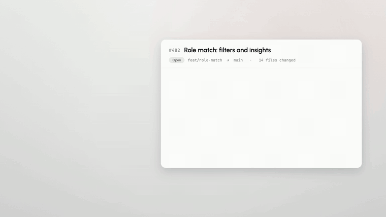
</p>

<p align="center">
  <a href="https://marinkayam.github.io/animatic/"><b>▶ Watch the film with sound (56 s)</b></a>
  &nbsp;·&nbsp; <a href="#get-it">Get it</a>
  &nbsp;·&nbsp; <a href="#how-it-works">How it works</a>
  &nbsp;·&nbsp; <a href="#in-your-design-system">Your design system</a>
  &nbsp;·&nbsp; <a href="#questions">Questions</a>
</p>

---

## Who it's for

**Designers who build.** If you design in code and open your own pull requests (with Claude Code, or by hand), this
is for you: your work gets reviewed as a design, not as a diff. You don't need to be a developer to set it up.

It also helps the people around you: **design leads** who review UI work, **developers** who want reviewers to see
a change without running the branch, and **PMs** who want to know what is about to ship.

## The problem

Design reviews happen on code. A reviewer opens a pull request and sees 14 changed files, not the screen you
designed. To understand the change they have to check out the branch, run the app, find the right page and guess
which states matter. Most don't. So UI changes get approved without anyone really looking at them.

**animatic** is a skill for [Claude Code](https://claude.com/claude-code). It works inside your code project, reads
each pull request, and puts a 30–75 second video at the top of it: what changed for the user, recorded from the
PR's real code, with title cards and captions in your own brand.

<p align="center">
  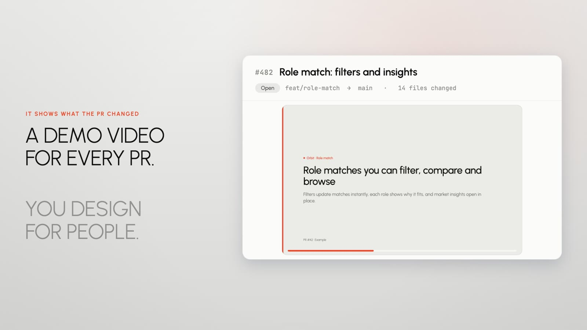
</p>

## What you get

A real video, made with this skill, of a fictional job-matching app ([`example/`](example)):

<p align="center">
  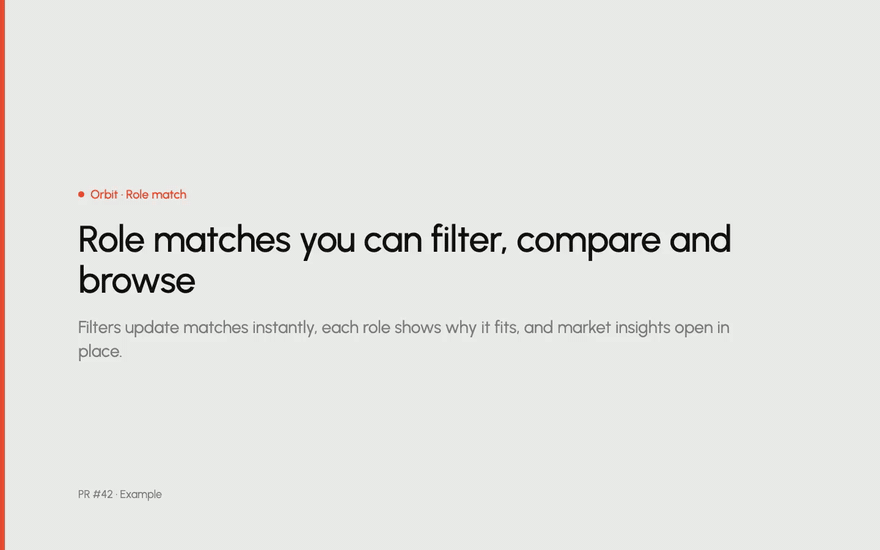
</p>

- **A title card**: the PR in plain language.
- **3–6 scenes**, one idea each: the real screen, a visible cursor, the thing that changed highlighted, a short caption.
- **An end card**: what changed, in bullets.
- **On the PR**: it plays right in the description, above the text. No link to click, no file to download.

<sub>The example app's visual design is based on a design concept found on Pinterest and is used for demonstration only. Every name, text and number in it is fictional. If it is your design and you would like credit or want it removed, please open an issue.</sub>

## Get it

Open Claude Code in your app's repo and say one sentence:

> **Set up https://github.com/Marinkayam/animatic for me.**

That's the whole install. Claude does the rest and comes back with **one** short round of questions.

### 1. One sentence

Claude installs the skill for you (nothing is added to your repo) and checks the tools it needs.

<p align="center">
  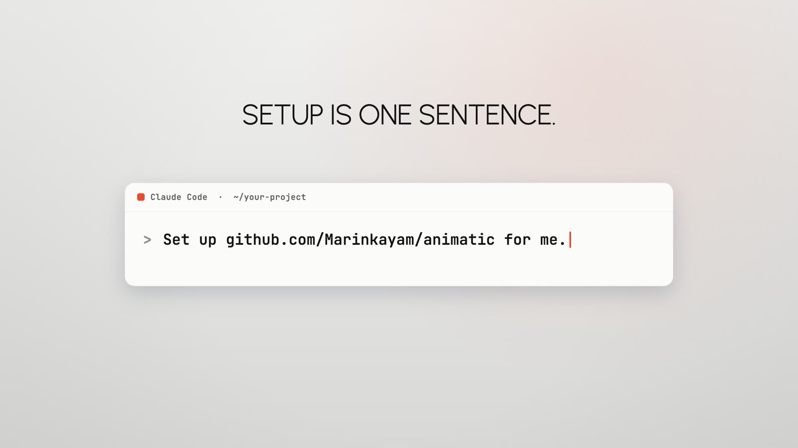
</p>

### 2. It learns your design system

Claude reads your colour tokens, fonts, radius and content guide on its own, then shows you a preview card and asks: *does this look like you?*

<p align="center">
  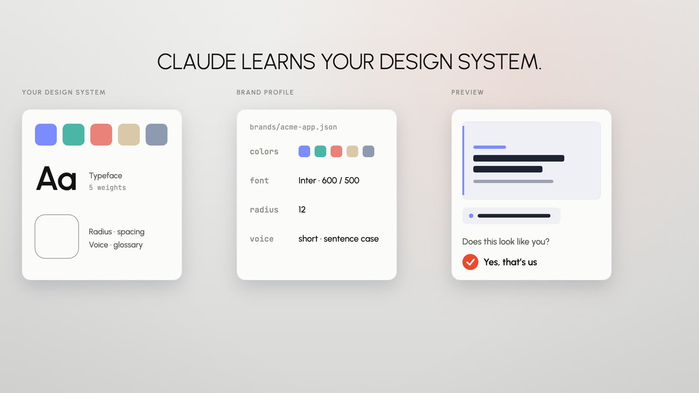
</p>

### 3. Then you do nothing

Open a pull request and animatic starts by itself. There is no command to remember.

<p align="center">
  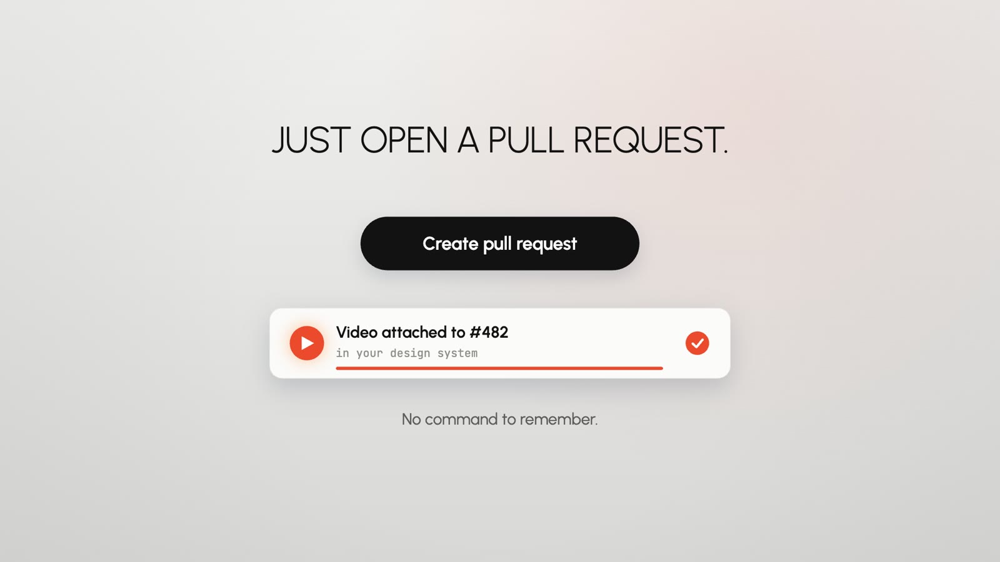
</p>

You also sign in to GitHub once, in a browser window Claude opens, so the videos can be attached.

Needs macOS (Linux should work too, it's less tested), [Claude Code](https://claude.com/claude-code), Node 18+, [`gh`](https://cli.github.com) and
`ffmpeg`. Claude checks these and tells you the one command for anything that's missing.

## How it works

For every pull request that changes something a user can see:

### It reads the PR, storyboards it, and records your real code

Claude finds what changed *for the user* (screens, states, copy, interactions), writes 3–6 scenes, and records each one from the PR's own branch with Playwright. Your checkout is never touched.

<p align="center">
  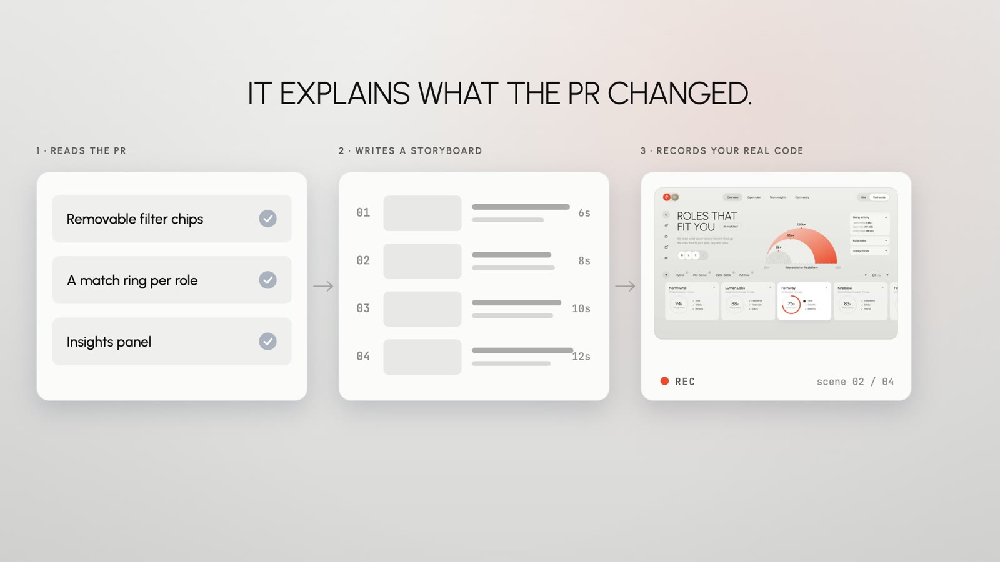
</p>

### Cards and captions come out in your brand

Title card, end card and captions use your colours, your typeface and your tone of voice.

<p align="center">
  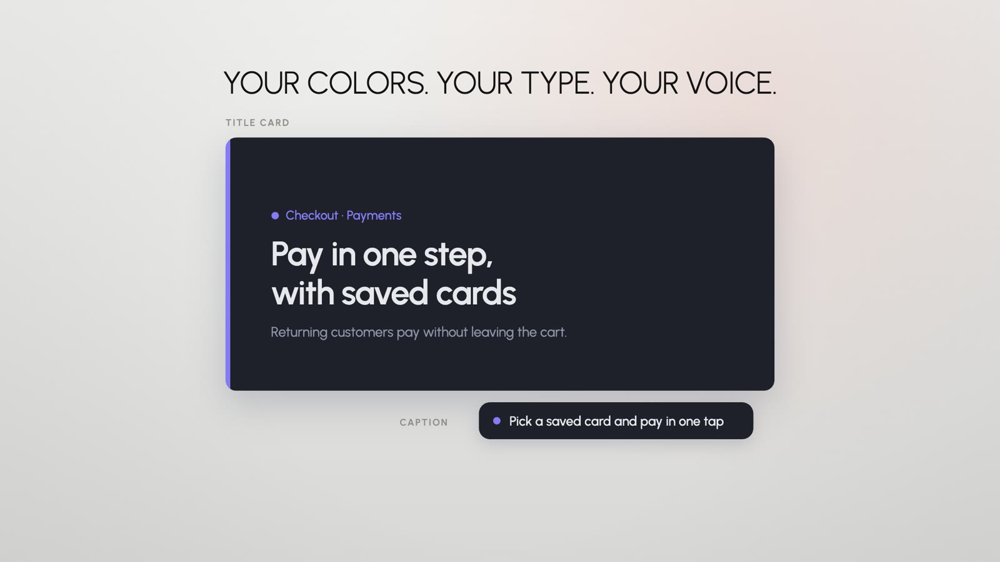
</p>

### The video lands at the top of the PR

Reviewers see the change before they read a line.

<p align="center">
  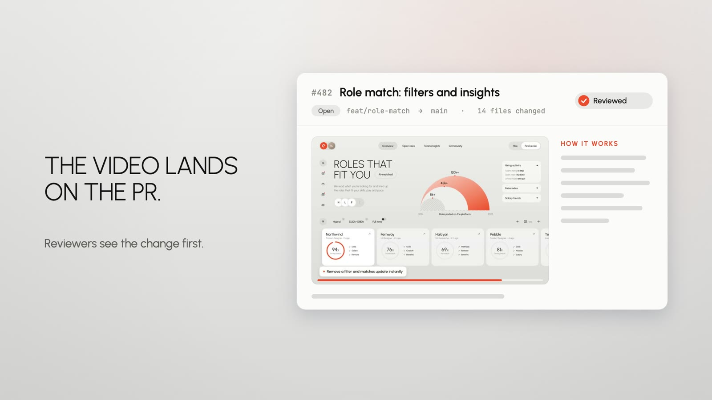
</p>

### And it keeps going

Every new PR gets its film. When a PR changes after review, the video is refreshed. PRs with nothing to see (docs, tooling) are skipped.

<p align="center">
  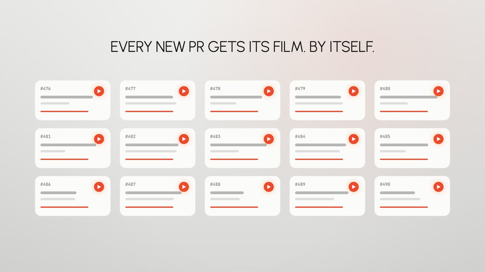
</p>

Before a video is attached, Claude checks it: a frame from every scene, the right screen, captions that don't cover
the subject, no loading or error frames, no real data.

## In your design system

The same video, in three different brands. Nothing here is a template you fill in: Claude reads your product's
tokens and fonts and writes a small **brand profile** for your repo.

<p align="center">
  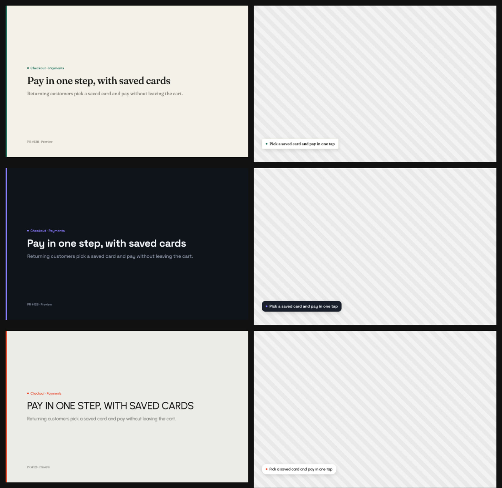
</p>

The profile holds your colours, typeface, corner radius, caption voice and glossary, where it is safe to record,
and any working rules for your repo. It lives on your machine, one file per repo
(`~/.claude/skills/animatic/brands/<owner>-<repo>.json`, [what's in it](skill/brand.schema.md)).
Change it by telling Claude: *"make the captions bolder"*, *"we changed our font"*, *"use our dark theme"*.

## Steer it in plain words

You never have to open a settings file.

| Say | What happens |
|---|---|
| "show me videos before attaching" | Claude makes each video, shows it to you, and attaches it on your yes |
| "just attach them" | back to fully automatic |
| "pause animatic" / "turn it back on" | stops and resumes the automatic videos |
| "skip this PR" | no video for that one |
| "redo the video for 482" | makes it again (`/animatic 482` works too) |
| "make the captions bolder" | updates your brand profile and shows you the new preview |

## Questions

**Do I need to know how to code?**
No. You need Claude Code open in the project. Everything else is that one sentence and one sign-in.

**Does it record my real product, with real customers in it?**
No, and it is told never to. It records demo, mock-data, Storybook or local environments only. Production and
staging hosts go on a never-record list in your brand profile.

**Does it change my repo?**
No. The skill installs in your home folder. Each video's working files go in `.animatic/` inside the repo, which
git is told to ignore locally. Nothing is committed.

**Can I see a video before it goes on a PR?**
Yes. At setup you choose: fully automatic, or "show me first". You can switch any time by saying so.

**What does it cost?**
The skill is free and open source. It runs in your own Claude Code, so making a video uses your Claude usage like
any other task.

**Private repos, company SSO, GitHub Enterprise?**
All work. The sign-in step handles SSO, and `--host` covers GitHub Enterprise Server.

**What if a PR changes after the video was made?**
The next time Claude Code starts in the repo it notices, re-records only the scenes the new commits touch, and
replaces the video. A plain merge from the base branch doesn't trigger anything.

## Try the example

[`example/`](example) has a small fictional app, its brand profile, the storyboard, the cards and the recording
script Claude would write for a PR. After setup, from this folder:

```bash
export ANIMATIC_BRAND=example/brand.json      # the example's brand profile
node example/record.mjs                        # records 5 scenes into example/out/
cp example/cards.json example/out/ && node skill/tools/cards.mjs example/out
bash skill/tools/compose.sh example/out        # -> example/out/animatic.mp4
```

## What's inside

| File | What it does |
|---|---|
| [`SETUP.md`](SETUP.md) | The setup Claude follows: install, read the design system, one round of questions, make it autonomous |
| [`skill/SKILL.md`](skill/SKILL.md) | The skill: how Claude scopes a PR, storyboards, records, checks and attaches |
| `skill/scripts/auto-hook.mjs` | What makes it autonomous: Claude Code hooks for new and changed PRs |
| `skill/scripts/upload.mjs` | Attaches the video to the PR and remembers which commit it shows |
| `skill/tools/brand.mjs`, [`brand.schema.md`](skill/brand.schema.md) | Your brand profile: how it's found and what's in it |
| `skill/tools/rec-lib.mjs` | Recording helpers: one clip per scene, a visible cursor, smooth moves, highlights |
| `skill/tools/cards.mjs` | Title, end and caption cards in your brand (`--preview` shows a sample) |
| `skill/tools/compose.sh` | ffmpeg: trims each scene, overlays captions, joins everything |
| `skill/tools/wt.sh` | Records the PR's own branch in a throwaway worktree, without a second install |
| [`example/`](example) | A fictional app with its brand profile, storyboard, recording script and finished video |

## Good to know

- **How the upload works.** GitHub has no public API for video attachments. `upload.mjs` does what you would do by
  hand: it opens the PR in a browser that keeps your own GitHub sign-in in a local profile, drops the file into the
  comment box, takes the attachment link, clears the draft, and writes the link into the PR description with `gh`.
  It is unofficial and can break when GitHub changes its page; Claude can usually repair it.
- **Size limits are GitHub's**: 10 MB per video on free plans, 100 MB on paid ones. The skill aims for under 10 MB.
- **Your sign-in stays on your machine.** Nothing is sent anywhere except GitHub.
- **No credentials in recording scripts**, ever.

## License

[MIT](LICENSE). Made by Marina Kaplan, with Claude Code. The film and every image on this page were made in code
with the skill's own tools.

**About the example.** The example app's visual design is based on a design concept found on Pinterest and is used for demonstration only. Every name, text and number in it is fictional. If it is your design and you would like credit or want it removed, please open an issue.
